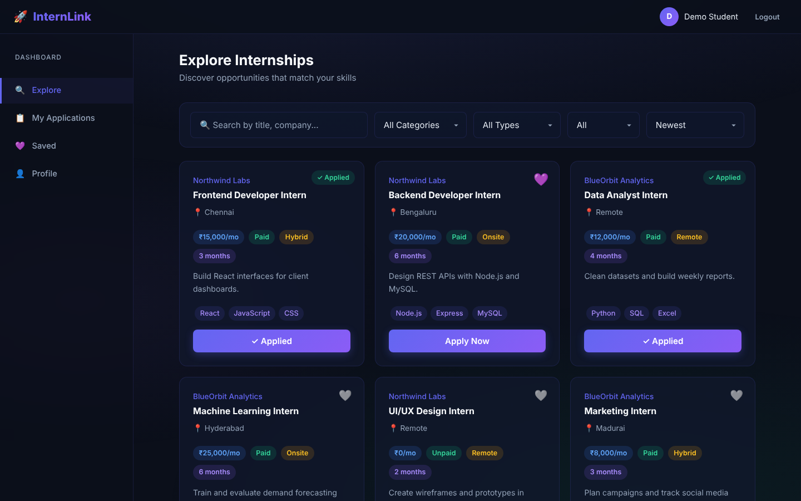
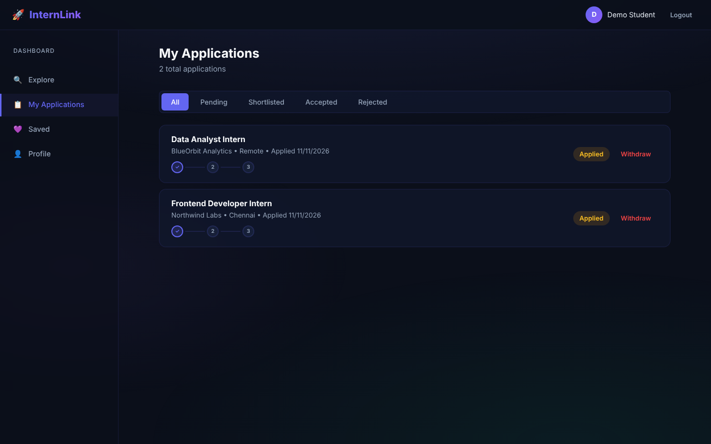
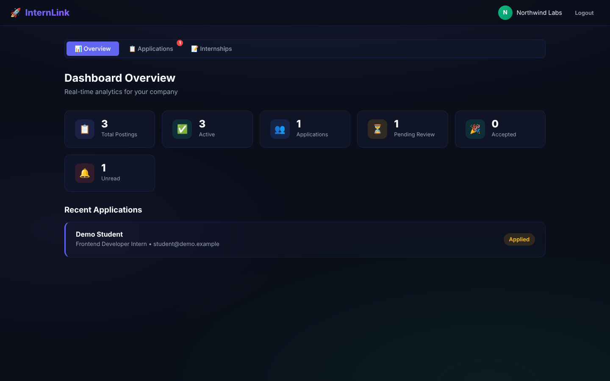

# InternLink

An internship portal that connects students with companies. Students browse and apply for internships and track their applications; companies post openings and review applicants from a dashboard.



## Features

**For students**
- Sign up, log in and maintain a profile (college, skills, bio)
- Browse internships with search, category, job type and payment filters, plus sorting
- One-click apply, with duplicate applications blocked at the database level
- Track application status and withdraw applications
- Save internships to a bookmarks list
- Unread badge when a company updates an application

**For companies**
- Company accounts with their own login
- Post, edit, deactivate and delete internships
- Review applicants and update their status
- Overview dashboard: postings, applications, pending reviews, accepted and unread counts

## Screenshots

| My applications | Company dashboard |
|---|---|
|  |  |

## Tech stack

| Layer | Tools |
|---|---|
| Frontend | React 19 (Create React App), plain CSS |
| Backend | Node.js, Express 5, bcrypt |
| Database | MySQL via `mysql2` (tables are created automatically on first start) |

## Project structure

```text
InternLink-backend/
  server.js        REST API (auth, internships, applications, bookmarks, profiles, stats)
  db.js            MySQL connection pool and schema initialisation
  .env.example     Environment template
internlink-frontend/
  src/App.js               App shell, navigation and toasts
  src/Internships.js       Explore page with search and filters
  src/MyApplications.js    Application tracking
  src/Bookmarks.js         Saved internships
  src/StudentProfile.js    Profile editor
  src/CompanyDashboard.js  Company overview, applicants and postings
  src/Login.js, Signup.js, CompanyLogin.js, CompanySignup.js
```

## Getting started

### Prerequisites

- Node.js 18 or later
- MySQL 8

### 1. Database

Create an empty database. The tables are created when the backend starts.

```sql
CREATE DATABASE InternLink;
```

### 2. Backend

```bash
cd InternLink-backend
cp .env.example .env      # then set your MySQL password
npm install
npm start                 # http://localhost:5000
```

### 3. Frontend

```bash
cd internlink-frontend
npm install
npm start                 # http://localhost:3000
```

## API overview

| Area | Endpoints |
|---|---|
| Student auth | `POST /signup`, `POST /login` |
| Company auth | `POST /company-signup`, `POST /company-login` |
| Internships | `GET /internships`, `GET /categories`, `POST /add-internship`, `PUT /update-internship/:id`, `DELETE /delete-internship/:id`, `GET /company-internships/:companyId` |
| Applications | `POST /apply`, `GET /my-applications/:userId`, `POST /withdraw-application/:id`, `GET /company-applications/:companyId`, `POST /update-status`, `POST /mark-seen`, `POST /mark-all-seen` |
| Bookmarks | `POST /bookmark`, `DELETE /bookmark/:userId/:internshipId`, `GET /bookmarks/:userId` |
| Profile and stats | `GET /user-profile/:id`, `PUT /update-profile/:id`, `GET /company-stats/:companyId` |

## Database

Five tables with foreign keys and cascade deletes: `Users`, `Companies`, `Internships`, `Applications` and `Bookmarks`. Unique keys on `(UserID, InternshipID)` stop duplicate applications and bookmarks.

## Known limitations

- The API has no session or token checks yet; the frontend keeps the signed-in user in `localStorage` and sends IDs with each request.
- The API URL is hardcoded to `http://localhost:5000` in the frontend.
- No automated tests beyond the Create React App default.

## Roadmap

- Add JWT authentication and protect the company and student routes
- Move the API URL to an environment variable and deploy a live demo
- Resume upload for applications
